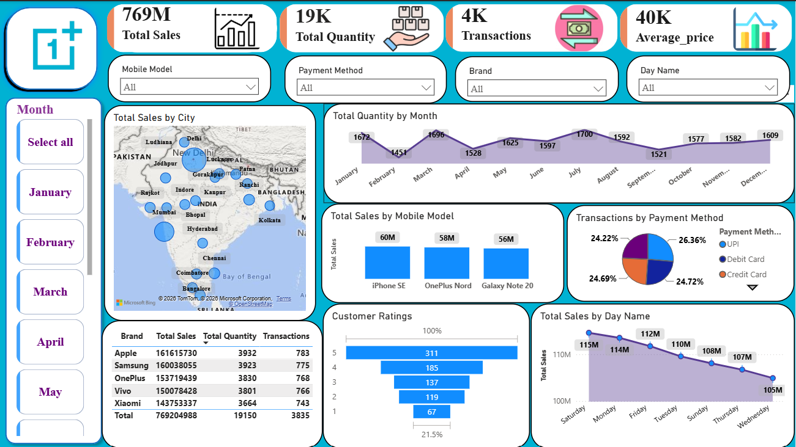

# 📱 Mobile Sales Dashboard – Power BI

## 📊 Project Overview

This project is an interactive **Mobile Sales Dashboard** developed using **Microsoft Power BI**.

The dashboard provides a comprehensive view of mobile sales performance by analyzing sales, quantity, transactions, mobile models, brands, payment methods, customer ratings, cities, months, and days.

The main objective of this project is to transform raw sales data into meaningful business insights that can help management understand sales performance and customer behavior.

---

## 🎯 Project Objectives

- Analyze overall mobile sales performance
- Track total sales, quantity, transactions, and average price
- Identify top-performing mobile brands and models
- Analyze sales performance across different cities
- Understand customer payment preferences
- Analyze customer ratings
- Identify monthly sales and quantity trends
- Compare sales performance across different days
- Provide an interactive dashboard for business decision-making

---

## 🛠️ Tools & Technologies

- **Power BI**
- **Power Query**
- **DAX**
- **Data Cleaning & Transformation**
- **Data Modeling**
- **Data Visualization**

---

## 📌 Key Performance Indicators (KPIs)

| KPI | Value |
|---|---:|
| Total Sales | 769M |
| Total Quantity | 19K |
| Total Transactions | 19K |
| Average Price | 40K |

---

## 📈 Dashboard Features

### 1. Sales by City
A map visualization showing the geographical distribution of mobile sales across different cities.

### 2. Quantity by Month
A line chart showing how the quantity of mobile products sold changes throughout the year.

### 3. Sales by Mobile Model
Comparison of sales performance among different mobile models.

### 4. Transactions by Payment Method
Analysis of transaction distribution across payment methods such as:

- UPI
- Debit Card
- Credit Card
- Other payment methods

### 5. Customer Ratings
Analysis of the number of customers based on their ratings.

### 6. Sales by Day Name
Comparison of sales performance across different days of the week.

### 7. Brand-wise Performance
A detailed table comparing:

- Brand
- Total Sales
- Total Quantity
- Transactions

### 8. Interactive Filters

The dashboard includes interactive filters for:

- Mobile Model
- Payment Method
- Brand
- Day Name
- Month

These filters allow users to explore the data dynamically.

---

## 📊 Dashboard Preview



---

## 🧹 Data Preparation

The data was prepared using **Power Query**.

The major data preparation steps included:

- Removing unnecessary columns
- Handling missing values
- Changing data types
- Cleaning and transforming data
- Creating calculated columns
- Extracting date-related information
- Preparing data for analysis

---

## 🧮 DAX

DAX was used to create important measures and calculations for the dashboard.

Examples include:

- Total Sales
- Total Quantity
- Total Transactions
- Average Price
- Monthly Sales
- Brand-wise Sales
- Customer Rating Analysis

---

## 📊 Data Visualization

Different Power BI visuals were used to communicate insights effectively:

- KPI Cards
- Line Charts
- Bar Charts
- Pie Charts
- Map Visualization
- Tables
- Slicers
- Funnel-style visualization

---

## 💡 Key Insights

Some important observations from the dashboard include:

- **Apple** generated the highest total sales among the displayed brands.
- **iPhone SE** was one of the highest-performing mobile models by sales.
- **UPI** represented a significant share of transactions.
- Sales and quantity varied across different months and days.
- Customer ratings can be used to understand customer satisfaction patterns.
- City-level analysis helps identify geographical differences in sales performance.

---

## 🧠 Skills Demonstrated

Through this project, I demonstrated my ability to:

- Perform data cleaning
- Transform data using Power Query
- Create DAX measures
- Build data models
- Create KPIs
- Design interactive dashboards
- Analyze business data
- Create meaningful data visualizations
- Extract actionable business insights

---

## 📂 Project Files

```text
Mobile-Sales-PowerBI-Dashboard/
│
├── Mobile_Sales_Dashboard.pbix
├── Dashboard.png
└── README.
